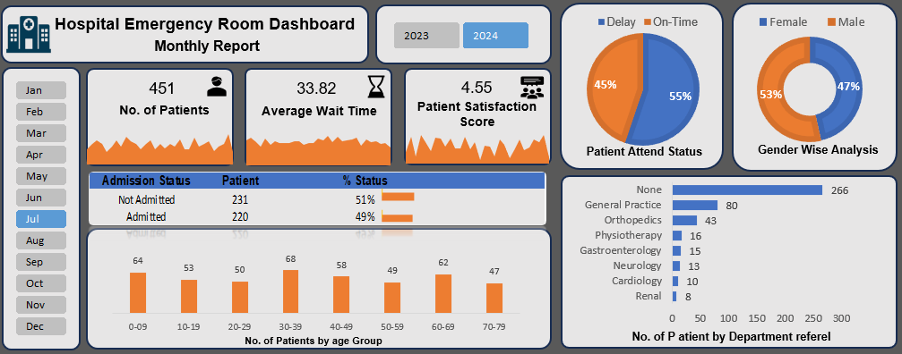

# Hospital Emergency Room Dashboard

## Overview
An interactive Excel dashboard built with Power Pivot and PivotCharts to analyze hospital emergency room visits, wait times, patient satisfaction, admission status, age groups, and department referrals.

## Dashboard Preview

## Files
* `Dashboard_preview.png` — Dashboard screenshot
* `Hospital_Emergency_Room_Data.csv` — Raw dataset

## Features & Skills Used
* **Power Pivot & Data Modeling:** Built a Calendar Table and configured custom month sorting.
* **Interactive Drill-Downs:** Clicking on the KPI cards (*No. of Patients*, *Average Wait Time*, or *Patient Satisfaction Score*) navigates to their detailed trend sheets.
* **Data Visualization:** Created PivotTables, PivotCharts, KPI cards, and interactive Year/Month slicers.
